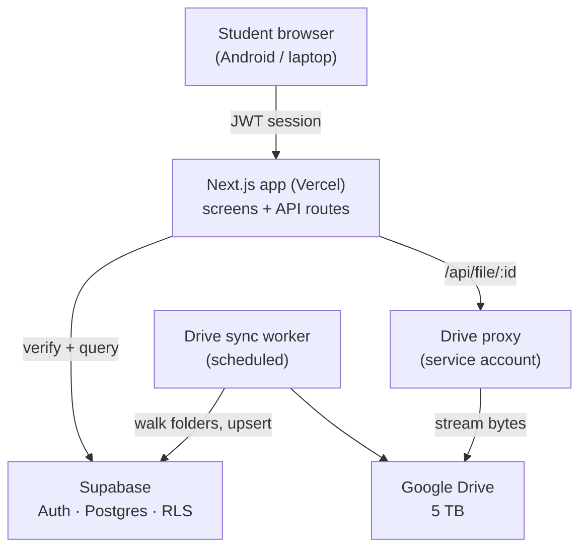
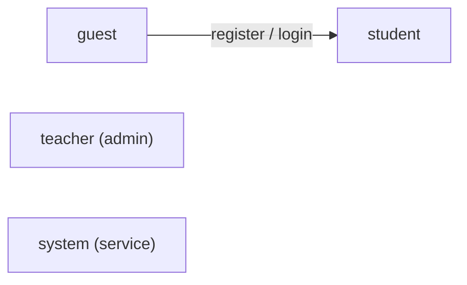

# NotesHub — Overview & Architecture

> Concise, AI-readable summary. Supabase backend + Google Drive storage + Next.js front end. Zero recurring cost.

---

## 1. What it is

A web app where a teacher publishes study notes/books (already stored in a Google Drive folder) and
students read them from **Android or laptop**. Students register with name, course, roll number, email
and password; browse a **flat, search-first catalogue**; read in a **protected, watermarked viewer**; and
**resume from the exact page** they left, on any device. A notifications section carries teacher
announcements and automatic events.

**Design goals:** one place for notes · search-first · cross-device resume · deter downloading ·
₹0/month.

---

## 2. Stack

| Layer | Choice |
|---|---|
| Front end | Next.js (App Router) + Tailwind + shadcn/ui |
| Hosting | Vercel (Hobby) |
| Auth | Supabase Auth (email/password, Google OAuth, magic link) |
| Database | Supabase Postgres (+ Row-Level Security) |
| Server logic | Next.js route handlers + Supabase Edge Functions |
| File storage | Google Drive (teacher's 5 TB), via a service account |
| Reader | PDF.js (renders to canvas) |
| Search | Postgres full-text (`tsvector`) + `pg_trgm` |
| Native wrap (later) | Capacitor (Android `FLAG_SECURE`) |

---

## 3. High-level architecture

**Key rule:** the browser **never** talks to Google Drive directly. Every file passes through an
access-checked proxy.

### Core flows (short)
- **Read:** tap book → backend issues a short-lived signed token → verifies JWT + access → streams bytes
  from Drive → PDF.js renders to canvas with the student's watermark → page position saved via
  `POST /api/progress`.
- **Browse/Search:** `GET /api/documents?q=…&category=…` returns only granted + published books; the UI
  hides everything else.
- **Sync:** a cron walks the shared Drive folder, upserts files into `documents`; top-level folders become
  categories; new books fire an automatic notification.
- **Resume:** `reading_progress` is keyed by `(student_id, document_id)` and upserted on every page turn,
  so any device resumes from the same page.

---

## 4. Role-based access control (RBAC)

**Three roles**, stored as `profiles.role`: `student`, `teacher`, `system`.

### Permission matrix

| Capability | guest | student | teacher | system |
|---|:--:|:--:|:--:|:--:|
| Register / login | ✅ | ✅ | ✅ | — |
| View own profile | — | ✅ | ✅ | — |
| Browse & search catalogue | — | ✅ | ✅ | — |
| Read a granted book | — | ✅ | ✅ | — |
| Save / resume reading position | — | ✅ | ✅ | — |
| Receive notifications | — | ✅ | ✅ | — |
| Add / edit / delete notes & categories | — | — | ✅ | — |
| Grant / revoke access (course or student) | — | — | ✅ | — |
| Block / unblock / delete users | — | — | ✅ | — |
| Send announcements | — | — | ✅ | — |
| View analytics & activity logs | — | — | ✅ | — |
| Sync Drive → catalogue | — | — | — | ✅ |

### Enforcement (three layers)
1. **Auth layer** — Supabase issues a JWT; `profiles.role` decides the role.
2. **API layer** — route handlers guard by role (e.g. `/api/admin/*` → teacher only; `/api/sync/drive` →
   secret only).
3. **Database layer (source of truth)** — Row-Level Security, default **deny**:
   - `profiles` → own row only (teacher: all rows).
   - `documents` → readable when a matching `access_grants` row exists (for the student **or** their
     course) **and** `is_published = true`.
   - `reading_progress`, `notification_reads` → owning student only.
   - `notifications` → audience match; insert teacher-only.
   - Admin tables/actions → teacher-only via policy.

---

## 5. Data model (brief)

| Table | Purpose | Key columns |
|---|---|---|
| `profiles` | users | `id`, `full_name`, `roll_number` (unique), `course_id`, `role` |
| `courses` | batches | `id`, `name`, `code` |
| `categories` | Drive top-level folders | `id`, `name`, `drive_folder_id` |
| `documents` | books/notes | `id`, `drive_file_id`, `title`, `category_id`, `course_id`, `page_count`, `is_published`, `search_tsv` |
| `access_grants` | who can read what | `student_id?`, `document_id?`, `course_id?`, `granted_by` |
| `reading_progress` | resume position | `student_id`, `document_id`, `last_page`, `updated_at` (unique pair) |
| `notifications` | messages | `title`, `body`, `type` (manual/auto), `audience` |
| `notification_reads` | read state | `notification_id`, `student_id`, `read_at` |
| `view_logs` | audit trail | `student_id`, `document_id`, `page`, `created_at` |

---

## 6. Content protection (important caveat)

- **Download prevention — achievable:** authenticated proxy, short-lived signed tokens, PDF.js canvas
  render (no download/print buttons), right-click/shortcut suppression, per-student watermark, rate limits.
- **Screenshot / screen-recording — only partial on the web:** a browser cannot block OS screenshots or
  OBS/Zoom recording (no web API exists; DRM only covers video streams). Deterrents only.
  **True blocking needs a native app** → Capacitor + Android `FLAG_SECURE`. Watermarking is the real
  backstop.

---

## 7. Out of scope (v1)

Payments · offline reading · in-PDF full-text search (title/tag search only) · video DRM · native app
(planned later).

---

## 8. API surface (quick)

| Route | Purpose | Role |
|---|---|---|
| `GET /api/documents` | list / search catalogue | student |
| `GET /api/file/:id` | stream file from Drive | student (granted) |
| `POST /api/progress` | upsert reading position | student |
| `GET /api/notifications` | list + unread count | student |
| `POST /api/admin/documents` | publish / link a note | teacher |
| `POST /api/admin/grants` | grant access | teacher |
| `POST /api/admin/users/:id` | block / delete user | teacher |
| `POST /api/sync/drive` | run Drive sync (cron) | system (secret) |
